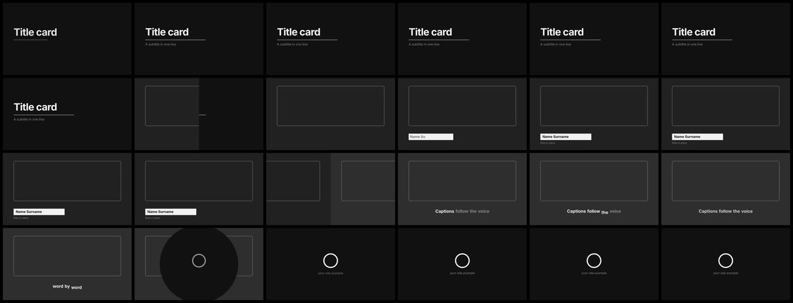

# film-blocks

**The idea:** every everyday piece of a film (title card, scene transitions, a lower third, word-timed
captions, an end card) built from `lib/blocks.js` in one 12-second HyperFrames film, so an agent can lift
any of them into a real film.

Engine: HyperFrames, 16:9, 12 s, 30 fps, no GSAP, no sound. Tier: free.
Run it: `fcwm new <film> --format 16x9 --duration 12`, copy this `index.html` over the film's, then
`fcwm render <film> --check`.

## Timeline

| Time | On screen | Block |
| --- | --- | --- |
| 0 - 3.5 s | Title, a rule drawing under it, a subtitle | `titleCard` (spring in, already moving at frame 0) |
| 3.5 s | Wipe to scene 2 | `transition(t, 3.5, { kind: 'wipe' })` |
| 4.2 - 6.8 s | Lower third: bar extends, name and role slide out of it | `lowerThird` |
| 7.0 s | Push to scene 3 | `transition(..., { kind: 'push' })` |
| 7.4 - 9.5 s | Captions, word by word, the spoken word pops | `captionLines` + `caption` |
| 9.5 s | Iris to the end card | `transition(..., { kind: 'iris' })` |
| 9.35 - 12 s | Mark settles, one line under it, held 2 s | `endCard` |

## Why it is built this way

- **One state per scene, from t.** `sceneState(t, i)` follows the transition into a scene until it is
  over, then the transition out of it. Transitions never overlap, so each scene has exactly one state at
  any time and frames can render in any order.
- **Blocks return numbers, the film owns the look.** `css(state)` turns a state into opacity, transform
  and clip-path; colours and type are CSS variables (a brand kit's `brand.css` replaces them).
- **Captions from timed words.** Feed the word list a speech-to-text tool returns; `captionLines` breaks
  it into lines of at most `maxChars` and starts a new line at a pause. Only the spoken word moves:
  moving words that are not spoken yet makes the line look jittery.
- **No empty frames.** The title is mid-rise at frame 0 (the thumbnail), and the end card starts while
  the iris is still opening, so the frame between them is never the bare ground (QA `blankFrames`).
- **The last line is held 2 s.** HyperFrames' check flags a closing line that is on screen too short to
  read; the end card starts early enough to clear it.

## Transitions

`transition(t, at, { kind, dur, direction })` with kind `cut`, `fade`, `dip`, `wipe`, `push`, `slide`,
`zoom` or `iris`; `at` is the middle of the transition. Pick one or two kinds per film and keep them on
the beat grid; a different transition at every cut reads as a template demo, not a film.
