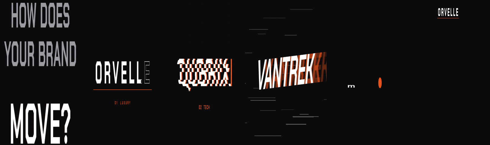

# Recipe: six ways to move (kinetic type)

A 22 s vertical reel, 120 BPM, 9:16. A question hook ("HOW DOES YOUR BRAND MOVE?"), six invented
wordmarks that each move with their own personality, a recap with all six at once. Canvas 2-D, pure
function of time on the motion-reel harness (`lib/motion.js` from the engine).

The six names (ORVELLE, QUBRIX, POPLI, VANTREK, mossa, LEDGERLY) are invented placeholders for the
demo. Use your own copy. The original end card was the studio's own logo and is not part of this recipe.

## Structure (beats)

| Beats | Section | What happens |
| --- | --- | --- |
| 0-4 | Hook | Two lines fly in from opposite sides, word by word on the beat; "MOVE?" lands hardest on beat 2 and flickers through four of the styles |
| 4-10 | Luxury | Outlined letters rise out of the baseline one by one, a hairline underline expands, a fill sweeps left to right |
| 10-16 | Tech | Junk characters resolve letter by letter, glitch slices, a blinking caret |
| 16-22 | Playful | Letters drop, squash on landing, then hop; one letter does a full flip |
| 22-28 | Sport | Italic word slams in from off-screen with accent echoes on the kicks; speed lines |
| 28-34 | Wellness | Lowercase letters grow from a ground line on a soft spring and sway; a sun rises behind |
| 34-40 | Finance | Split-flap tiles flip to the name; a chart draws itself |
| 40-44 | Recap | Six bands, each looping its style, slide in alternately from left and right |

## Why it works (read these parts of `film.js`)

- **One grid for picture and sound** (`HITS`, line 32): every visual accent is listed with its sound,
  and `sfx.mjs` voices exactly that list. Letter landings carry pitched notes (`'pop'` at C5, Eb5, F5...)
  so the type literally plays a melody.
- **Personality by motion, not by font.** All six names use the same display face. `lux()` (line 92),
  `tech()` (121), `play()` (157), `sport()` (187), `eco()` (215) and `fin()` (242) each give letters
  their own timing, physics and reason to move. `lib/type.js` has these as renderer-agnostic functions.
- **Every style has a `loop` mode** so the recap can reuse it at rest. Write a style once with an
  entrance and a loop; the recap and the hook come for free.
- **Camera punch on the hook** (`punch`, line 55): a 2.5 % scale bump on each word and 6 % on "MOVE?",
  plus a short shake. Energy from motion; exposure never changes.
- **Glyph-level layout** (`word()`, line 61): measure once at 100 px, scale per use, and place each
  glyph by its centre so tracking can animate without re-measuring.
- **Grain in `post`**, after motion-blur accumulation, so it is not averaged away.

## Related rejections

Two rows of `knowledge/lessons.md` are what this film is built to avoid: a centred word with a simple
fade or pop ("letters look like a draft") and the same layout six times. Each section here has its
own composition and its own way of moving.

## Run it

Needs the motion-reel engine (vendored into FCWM in stage 2). Put two fonts in `fonts/display.ttf`
(and `script.ttf` if you add one), then render as any motion-reel film. `audio/score.py` writes the
music and `beats.json` (synthesized, F minor, uses the engine's `dsp.py`).
