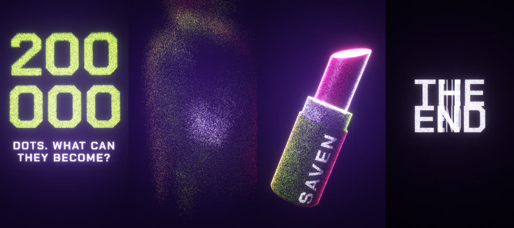

# Recipe: 200,000 dots (point-cloud flight)

A 19 s vertical reel, 140 BPM, 9:16, three.js. Dots rush in and spell a question, then burst and
stream from one product shape to the next (perfume, can, phones, lipstick, camera, sunglasses) with
the camera chasing them, then form the end card, which blows apart into black.

The product brand names printed on the objects are invented placeholders. The original end card was
the studio's logo; `drawEndCard()` is a neutral stand-in whose pixels become the last dot shape.

## Why it works (read these parts of `film.js` and `gl.js`)

- **Same point count in every shape.** `NO = 180000` object points plus ambient dust up to 200,000
  (line 36). Indices line up between shapes, so a morph is a per-index interpolation.
- **Morton ordering** (`morton()` line 91, `normalize()` line 95): each shape's points are sorted
  along a 3-D Z-order curve in its own posed space, so point k of one shape sits where point k of the
  next one sits. The morph flows instead of scattering. `lib/points.js` has this as `mortonSort`.
- **Staggered arrival** (`ST`, line 35, and the `stg` term in `renderGL`, line 217): 65 % top-down
  sweep, 35 % random. The new shape draws itself from the top.
- **Burst, arc, comet.** Points first push out of the old shape's centre, then travel on an arc
  (`arcX`, `arcY`) that alternates side per shape, with a short brightness flash only while in flight.
- **Camera chases, never enters the cloud** (`camLerp`, line 210): it starts after the burst, lands
  with the swarm, banks into the turn and pulls back mid-flight so the stream reads as a comet. This
  fixed the "fog between products" rejection.
- **Lit points** (`gl.js`): each point keeps the normal of the surface it was sampled from, so the
  cloud is shaded like a solid (key, rim, specular). Points facing away are nearly black. Depth of
  field grows the sprite and lowers its alpha away from the focus. `lib/three/points-material.js`
  is this shader as a reusable factory.
- **Occluders**: the sampled meshes are drawn depth-only, so the far side of a bottle does not show
  through its front.
- **Steady exposure**: bloom stays at 0.4 except one decaying burst on the final blast.
- **The end card is built from its own pixels** (`cardShape()`, line 183): the crisp card is rendered
  to a canvas, sampled into dots on a plane the camera sees exactly full-frame, then the crisp card
  fades in over the dots pixel for pixel.

## Run it

Needs the motion-reel engine and `three` (`npm i three`). Put a display font in `fonts/display.ttf`.
On a machine without a GPU, WebGL falls back to software rendering and 3-D frames are ~80x slower.
`audio/score.py` writes the music (G minor electro house) and `beats.json`.
