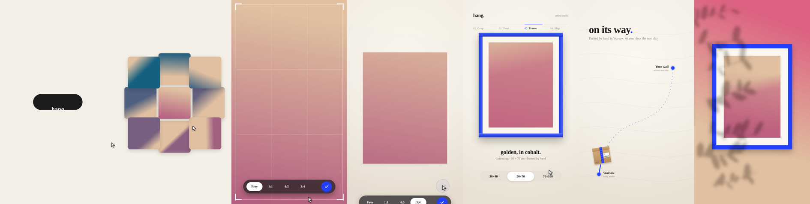

# Recipe: UI story with a cursor (HTML/DOM)

A 29 s vertical product story for an invented print shop ("hang."): a wordmark squeezes into a dot,
the dot becomes a button, a click opens a photo grid, the photo is cropped, toned and framed in UI,
ordered, shipped across a map, and ends as a framed print on a wall. One continuous move, no cuts,
120 BPM. Built as plain HTML: `seek(t)` rewrites the DOM for time t. The same approach works in any
HTML-based engine (HyperFrames).

Photos (`img/*.jpg`) and fonts (Archivo, Geist; both under the SIL Open Font License, available from
Google Fonts) are not included. Without them the film still renders with fallbacks.

## Why it works (read these parts of `film.html`)

- **Pure function of time in the DOM**: `window.seek(t)` builds the whole frame as an HTML string from
  t alone (line ~524). No CSS transitions, no animation clock; `render.js`-style workers can render
  frames in parallel and out of order.
- **The cursor is a chain of glides between actions** (`WP`, `CLICKS`, `cursorAt()`, lines 75-93):
  minimum-jerk moves of 0.38-0.7 s on a slight arc, arriving 0.12 s before each click, drags that
  follow the content exactly, a small hand drift that fades out around clicks, and a press dip.
  This fixed "the cursor goes stop, go, stop". `lib/cursor.js` is the reusable version.
- **Liquid glass without backdrop-filter** (`gfilter()`, `glass()`, lines 39-58): each glass panel
  holds its own clone of the layers behind it and bends them with an SVG displacement map, three
  channels at slightly different scales for dispersion. `lib/dom/glass.js`.
- **Camera iris as a logical transition** (`irisPath()`, line 60): in a film about photos, the cut
  passes through a shutter. `lib/dom/iris.js`.
- **Wordmark squeeze** (`wordmark()`, line 101): the word narrows through the font's variable width
  axis (font-stretch 125 % to 62 %) and then scales into the dot; at the end letters spring back out
  of the dot with overshoot (`wordmarkSpring()`, line 345). The film opens and closes on the same mark.
- **Glass letters** (`glassLetters()`, line 146): each letter pops on its own spring and holds a
  masked, magnified clone of the photo behind it.

## Rhythm, measured from the reference

The reference was stepped through every 0.25 s and its audio measured: ~120 BPM, -14.7 LUFS, the drop
at 6.0 s (not 8 s as first guessed) exactly when a zoom lands, a breakdown 22.5-26 s on the calmest
visual, the beat back on the final wordmark. Something changes every 0.25-0.5 s; no frame holds over
~1 s. The film follows that structure with its own story.

## Notes

- `sGlass` and `sStage` are an earlier cut left in the file; `seek()` uses `sOpen`, `sMid`, `sWall`.
- `audio/music.py` synthesizes the bed; its SFX lines expect a local sound bank (`sfx/`), not included.
