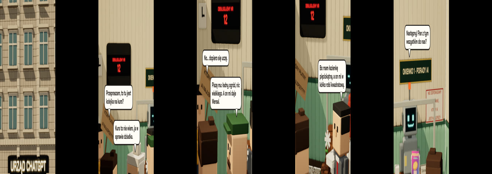

# Recipe: voxel comedy (3-D characters and dialogue)

A 54 s vertical satire in Polish, three.js voxel world. A newcomer queues in an office to "learn AI"
and every person ahead of him hands him their problem. Characters walk, turn, hold props and talk in
speech bubbles; the camera cuts between staged shots.

## Why it works (read these parts of `film.js`)

- **The script is the timeline** (lines 20-74): `scene()`, `say()`, `wait()`, `mark()` write scenes,
  lines and named events, and every duration comes from text length. Animation, camera and sound all
  read the same timeline (the score reads `timeline.json`, exported from `window.FILM_TIMELINE`).
  `lib/dialogue.js` is this pattern as a module.
- **Voxel builder with a matrix stack** (`build()` line 103, `part()` line 119): thousands of slightly
  rounded boxes with seeded colour jitter, one InstancedMesh per part. Parts are built around their
  pivot so arms and heads rotate at the joint. `lib/three/voxel.js` is the reusable version.
- **Characters as specs** (`character()` line 210 and `SPEC`): one function builds every character
  from a few numbers and small hair/face/body callbacks. Arm poses are separate groups switched by
  visibility, so a held object always has hands at its edges.
- **Walk driven by distance** (`track()` line 435, `pose()` line 454): leg swing and bob come from
  distance walked, so feet never slide; turns use minimum-jerk; breathing, head drift and seeded
  blinks keep idle characters alive. `lib/character.js`.
- **Camera as data** (`cameras()` line 643, `camAt()` line 634): each shot is two keys with a named
  focus point for depth of field and a slow push. `lib/camera.js`.
- **Bubbles anchored to heads** (`layoutBubble()` line 680): the head-top is projected to screen,
  the bubble is clamped inside the frame, and its tail points at the speaker.
- **Post stack**: ambient occlusion (GTAO), bokeh depth of field and a light bloom.

## Known gaps in this version (learn from them)

- Line timing here is `0.45 s + 0.03 s/char` (line 20) and some exchanges stack two bubbles. The
  designer rejected exactly this as "bubbles change too fast". The fix: `readingTime()` in
  `lib/type.js` (>= 1.5 s, ~0.7 s + 0.04 s/char) and one bubble at a time.
- Check coplanar faces before showing (signs on walls flickered) and check every character in 2-3x
  crops (an arm with a step, hands through a held object were caught late).

## Run it

Needs the motion-reel engine and `three`. Fonts go in `fonts/`. `?q=0.5` previews at lower quality.
Render without a GPU is slow (software WebGL). `audio/score.py` (bossa muzak, 104 BPM) reads
`timeline.json`, which you export from the page's `window.FILM_TIMELINE`.
